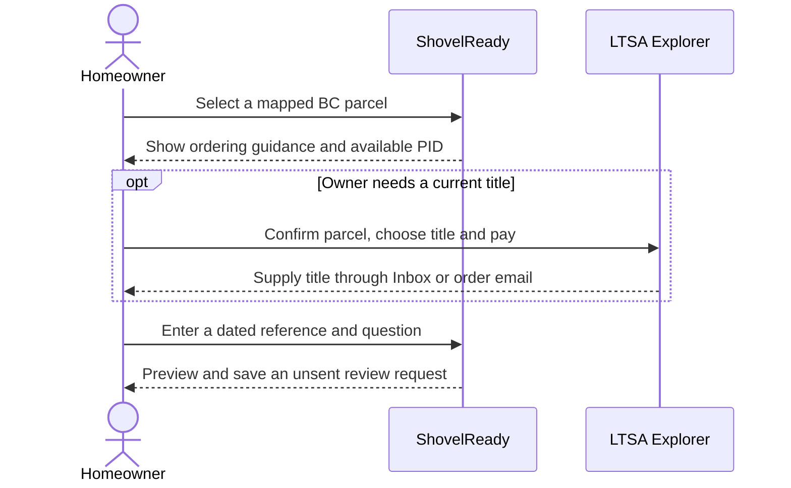

# BC title orders for the homeowner pilot

Reviewed November 19, 2026.

**Use the owner-directed LTSA Explorer route for the pilot.** Give the homeowner
a mapped parcel identifier (PID) to confirm when the match is unambiguous, the ordering instructions and
the PDF retrieval instructions. The homeowner can use a copy they already have
for discussion, or choose to order a fresh copy when it matters. Keep the title
step optional and preserve the rest of the screening journey. Treat the title
as a point-in-time reference for the next conversation. Registered charges may
point to separate documents whose terms and location need professional review.
[LTSA title guide](https://ltsa.ca/property-owners/how-can-i/search-for-a-title/)
· [LTSA document and plan guide](https://ltsa.ca/property-owners/how-can-i/order-a-document-or-plan/)

## Routes and evidence

| Route | What the published sources establish | Decision for ShovelReady |
| --- | --- | --- |
| **LTSA Explorer** | A member of the public can create a single-user account with credentials and MFA or use the BC Services Card option. Search the nine-digit PID or title number and confirm the result by PID, title number and land title district. Select the current title, review the fee in LTSA checkout and pay LTSA by card. The PDF can be downloaded from the Inbox for up to seven days, or saved from the order email when attached. Orders over the attachment limit use a sign-in link. A paid order can still show Processing. | Available as a homeowner-managed handoff. Show the selected PID and explain which item to choose. If the selected unit or title is ambiguous, verify the PID or ask LTSA or a registry agent before ordering. |
| **LTSA Title Direct** | LTSA identifies Title Direct as a web service for third parties and reports working with third-party software vendors. The BC government's PIMS integration documents separate test and production environments, integrator and LTSA user authentication, PID-based title summaries and an order keyed by title number and district. Its response interface contains an order ID, status, billing fields and structured title data. | Technically plausible. The public example establishes one integration pattern. Access for this startup, current provider documentation, fees and PDF fulfillment remain open. A general Enterprise account is a distinct onboarding step from API approval. |
| **Dye & Durham Title Search Online (TSOL)** | Dye & Durham appears in the registry-agent association directory linked by LTSA. TSOL advertises homeowner and professional use, a provider account with card payment, a PID search and a current copy for CAD $18.50 plus GST. The provider advertises immediate delivery and shows how to reopen the title search and receipt in Purchase History. | A documented external checkout alternative. The public material establishes a consumer portal. An embeddable order API, sandbox, title-number search, official PDF format, delivery expiry and ShovelReady's rights under a commercial agreement remain unconfirmed. |

Explorer sources. [Account registration](https://help.ltsa.ca/ltsa-explorer/request-account)
· [Order a current title](https://help.ltsa.ca/ltsa-explorer/search-titles-and-plans)
· [Download items](https://help.ltsa.ca/ltsa-explorer/download-items)

Title Direct sources. [LTSA operations report](https://ltsa.ca/wp-content/uploads/2020/11/LTSA-Ten-Year-Operations-Report.pdf)
· [LTSA annual report](https://ltsa.ca/wp-content/uploads/2022/06/LTSA_Annual-Report-2021-2022.pdf)
· [Government PIMS integration notes](https://github.com/bcgov/PIMS/wiki/External-Services#land-title-and-survey-authority-ltsa)
· [PIMS order response interface](https://github.com/bcgov/PIMS/blob/main/express-api/src/services/ltsa/interfaces/ILtsaOrder.ts)
· [Enterprise account request](https://help.ltsa.ca/ltsa-enterprise/request-account)

Intermediary sources. [LTSA registry-agent referral](https://ltsa.ca/property-owners/about-land-records/hire-a-professional/)
· [Registry-agent directory](https://bcapra.org/)
· [Dye & Durham TSOL product and pricing](https://apicanada.com/tsol/)
· [Dye & Durham purchase history help](https://apicanada.com/frequently-asked-questions/)

For Explorer, the April 1, 2026 schedule lists CAD $11.06 for a title search and
CAD $3.55 for a standard electronic transaction, with GST on the service charge.
That implies CAD $14.79 for one ordinary title using the standard charge,
assuming GST applies only to the service charge. The owner should use the
total shown before LTSA payment. Explorer purchases are generally final.
The public schedule also lists a discounted transaction charge for qualifying
deposit-account transactions. It supplies a baseline for cost comparison.
Title Direct onboarding fees, minimums, per-call charges and the applicable
production billing model require a written quote.
[LTSA fee schedule](https://ltsa.ca/fees/)
· [Explorer checkout instructions](https://help.ltsa.ca/ltsa-explorer/search-titles-and-plans)

## Permission to deliver a purchased title

The unified LTSA Customer Agreement effective March 3, 2026 supersedes the
separate Explorer and Enterprise agreements. Article 6.3(l) prohibits portal
scraping and automated form filling. Article 6.4 allows personal non-commercial
use and defines reasonable business purposes to include certain
specific-property research, advice and real estate services. It excludes
primary volume, discount or subscription resale. Uses outside the allowance,
including transmission and display, require prior written approval. LTSA's
local-government guidance distinguishes purchased records from fee-exempt
records and cautions about the risks of reselling even purchased copies. The
governing API or provider terms should confirm the exact proposed order,
delivery, display and retention flow in writing before a live integration.
An owner's request authorizes the requested transaction with ShovelReady and
does not supply registry rights or authority over every person's information
on a title. [LTSA Customer Agreement, arts. 6–7](https://help.ltsa.ca/ltsa-customer-agreement)
· [LTSA purchased and fee-exempt records guidance](https://ltsa.ca/government/local-government/working-with-ltsa/)
· [BC Personal Information Protection Act](https://www.bclaws.gov.bc.ca/civix/document/id/complete/statreg/00_03063_01/)

## Minimum flow if a provider approves integrated ordering

1. **Confirm the order.** Require a signed-in homeowner to select one matching
   current title after checking the PID and district. Show the source, product,
   total in CAD including taxes and service fees, refund terms, who receives
   the PDF and when platform access ends. Capture affirmative authorization for
   that order and amount. Keep proof of ownership distinct from the homeowner's
   instruction to order a public record.
2. **Prevent duplicate charges.** Record one durable order intent and use the
   same idempotency key for repeats with each provider that supports it. Keep
   payment and fulfillment status distinct and use hosted payment if ShovelReady
   bills the homeowner. Prefer authorizing payment at confirmation and capturing
   after fulfillment when the payment and provider contracts support it. Reconcile
   both ledgers using provider reference IDs. If order submission times out, look
   up the original attempt and resolve any charge before allowing resubmission.
   An intentional fresh title requires a new confirmation.
3. **Recover from delay or failure.** Show processing and allow the homeowner to
   return to the same order. On a confirmed failure, release a payment hold or
   issue the promised refund and show the receipt or support reference. Move
   charged orders without a usable PDF to manual reconciliation. Redeliver from
   the existing order where allowed. If a fresh purchase is required, explain why
   and request fresh consent. For Explorer, send the homeowner to the Inbox and
   order email before suggesting a new purchase.
4. **Minimize title data.** Prefer provider-hosted delivery if available. If
   ShovelReady must hold the PDF, encrypt it in private storage, check the order
   owner's authorization before each view or download, expire delivery links and
   log access without title contents. Use authenticated retrieval notifications
   with no attached title or public link. Keep the PDF and title contents out of
   analytics, logs, model inputs and builder exports. Set a documented deletion
   period tied to delivery, including backups, and retain only the order and
   billing metadata needed for support or applicable obligations. Confirm
   safeguards, access, co-owner information handling and whether any decision
   triggers the minimum retention rule before storing live title data.
   [BC Personal Information Protection Act, ss. 6–18, 34–35](https://www.bclaws.gov.bc.ca/civix/document/id/complete/statreg/00_03063_01/)

## Questions for LTSA and a provider

Ask [LTSA Customer Support](https://ltsa.ca/contact-us/) to route the following
to Title Direct onboarding and the team responsible for permitted use. LTSA lists
1-877-577-5872 (business professionals option 2, technical support option 3).

1. Can a BC property-planning startup qualify for Title Direct to order a
   single current title per explicit homeowner request? Which Enterprise
   account, integration agreement, security review and production acceptance
   steps apply? Who holds the LTSA account and submits the paid order?
2. Can you provide current API documentation and isolated test access with
   sample PIDs, no live records and no real charges? What test coverage is
   available for ambiguous title summaries, failed payments, expired documents
   and timeouts after acceptance?
3. Which calls incur fees in production? What do title searches, PDF retrieval
   and redelivery cost, including service charges, taxes, minimums, deposits and
   setup fees? When is the order charged? Can a confirmed missing or unusable PDF
   be redelivered or credited, and who reconciles an ambiguous submission?
4. Does the API deliver the unchanged LTSA-issued current-title PDF, alongside or
   separately from structured data? Can a PID return multiple current titles and
   what makes an orderable match unambiguous? What are the status lookup and
   delivery mechanisms, stable references, idempotency guarantees, availability
   window and support escalation for delayed or duplicate orders?
5. Does the applicable agreement expressly allow ShovelReady to order as the
   homeowner's agent, pass through the fee, display and deliver the unchanged PDF
   privately to the requesting homeowner and hold it briefly for redelivery?
   What purposes, notices, attribution, recipient verification, access,
   processors, hosting locations, retention and deletion rules apply? What may
   the homeowner share independently for professional review?

Ask [Dye & Durham TSOL](https://apicanada.com/tsol/) at 1-877-953-8253 whether it can contract for
that use case and answer the same test, pricing, fulfillment and rights
questions. Specify whether the offer is a referral to provider checkout, an
embedded checkout or an API. For embedded checkout or API, ask whose agreement
covers onward delivery, who bills and handles refunds, and whether the provider
can deliver the unchanged PDF directly to the requesting homeowner.

## Verification and remaining decisions

The fee schedule, account agreement, ordering and download help, provider
product pages and published government integration were checked against the
proposed homeowner journey. No accounts were opened, providers contacted,
credentials requested or orders placed. The government implementation does not
demonstrate PDF fulfillment and the published provider portal does not
establish API access or redistribution rights.

| Open item | Practical impact and next owner |
| --- | --- |
| Homeowner walkthrough of Explorer | Product research should observe a homeowner identify the right current title and find the LTSA download instructions. This checks usability of the external handoff. |
| Commercial/API approval and PDF delivery | Product owner should obtain written answers and a quote from LTSA before choosing an integration, then ask Dye & Durham if a comparable supported arrangement exists. Engineering should exercise duplicate, delayed and failed delivery in a provider-approved test environment before charging users. |
| Privacy and retention for uploaded or integrated documents | Product and privacy owners should review the real data flow, onward permissions and deletion terms before adding title ingestion or hosted PDF delivery. Keep title documents with the homeowner for the pilot. |
| Effect of registered instruments on a proposed placement | The homeowner's professional can obtain and interpret relevant instruments and plans when the decision warrants it. The reference step does not supply accepted siting evidence. |
