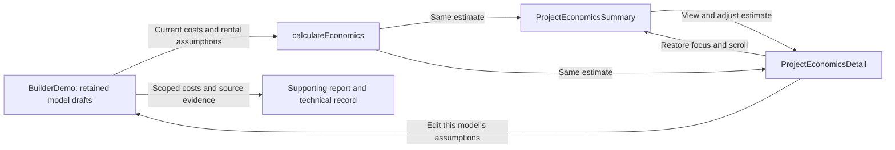

# Project economics

Decision recorded November 9, 2026. The estimate supports choosing whether to
explore a model or talk to its provider. The project assessment shows a compact
cost subtotal and optional rental figures. The estimate view keeps project costs,
rental income, and running costs and financing in one place.

The views use the same retained model draft, existing cost ledger and rental
calculation. Opening the estimate keeps the assessment mounted. Returning restores
the trigger and scroll position. Opening the editor holds the current placement
against a late automatic suggestion; the user can request a new placement from
the map. Each model keeps its own amounts, rent and placement. Rental preference is
shared for the project and revisable. A replacement property starts fresh amounts
and a fresh rental choice. Reloading clears in-session drafts; cost evidence can
be downloaded and imported explicitly.

## Starting assumptions

Amounts are editable CAD planning points for an accessible level site with nearby
available services. The four site allowances are available in the four supported
Victoria metro municipalities. If a prefab package has a price, add a default
only where the package identifies that work as separate. The interface separates
the prefab price from project installation and fees. Complete-scope estimates
still require the existing category coverage, tax treatment and currency checks.

| Line | Starting amount | Basis and scope |
|---|---:|---|
| Prefab building | Model 300 $187,000; Quadra 4 $224,000 | Captured CAD starting claims used as provisional points for the published configuration. The original unbounded claim, source and capture date are retained. Missing, incompatible, ambiguous-currency or stale claims cannot price this line. |
| Foundation and site work | $25,000 | Ordinary excavation and foundation. Evolv Modular's published $22,000–$60,000 reference band. |
| On-site service connections | $15,000 | Short private runs to existing available services. Evolv's $14,000–$70,000 band. Authority upgrades and new mains need separate pricing. |
| Delivery and lift | $15,000 | Local transport, typical crane and access. Evolv's $12,000–$30,000 band. Ferry, unusual traffic control and difficult lifts may cost more. |
| Development and permit fees | $8,000 | Reserve for authority application, permit and development charges, within Evolv's approximate $4,000–$22,000 band. Application timing, actual charges and waivers remain unresolved. Refundable deposits are separate. |

[Evolv Modular, “What Your Lot Decides”](https://evolvmodular.ca/) was checked
November 9, 2026. Its model line starts at 640 sq ft, and its published bands are
provider observations without a reported sample or estimate confidence. These are
ShovelReady scenario points inside the separate ranges. The page uses dollar
symbols; CAD is our disclosed planning denomination based on its Vancouver Island
context, not an explicit source currency declaration. No aggregate range was
derived from the page. [ORCA's FAQ](https://www.orcalgs.ca/faqs/) checked the
same day describes $25,000–$40,000 for excavation, foundation and utilities and
$10,000–$30,000 for delivery, cranage and anchoring on flat BC lots. Its $40,000
combined upper figure cross-checks the chosen foundation and services points. It
does not establish price, availability or installation terms for the selected model.

Prefab evidence comes from the existing [Model 300 source](https://www.auxbox.ca/model-300)
and [Quadra 4 source](https://hewinghaus.com/product/quadra-4-400-sqft-home/) catalogue captures.
Model 240's catalogue lacks a price. The C.H. Studio Pod's price lacks confirmed
currency and its exact residential and installation scope need provider confirmation.
A homeowner can enter a prefab-only CAD amount or supply a more detailed quote
through the existing cost entry controls.

No construction value is inferred from the prefab price to calculate a bylaw fee.
[Municipal fee research](../research/cost-fees-rent-listings-2026-10/municipal-fees.md)
records the conditional City of Victoria waiver, other charges, credits and
jurisdiction-specific gaps. Upgrades, taxes, professional work, contingency,
stairs, decks, landscaping, and site-specific service or access extras need
appropriate scope review. An unknown line stays unknown. An explicit included line
must link to a usable package without adding the same amount twice. A cost
entered for a different configuration, project or placement is held for recheck.

## Rental and payback

The existing [rental scenario](../rental-scenarios.md) uses Statistics Canada
table 46-10-0092-01 apartment asking rents by metro area and bedroom count. The
prefill has no suite-size adjustment. Annual income applies editable vacancy and
running-cost allowances to a full operating year. Debt payments are separate and
income tax is outside both figures. The estimate assumes a rentable self-contained
dwelling; provider scope and residential suitability still matter.

Simple payback divides the bounded CAD cost by positive annual income after
running costs. The subtotal calculation requires meaningful prefab pricing and
covered fees, delivery, site work and services. Where the project cost still has
open categories, the denominator is explicitly labelled cost subtotal. An
unbounded, incompatible or absent cost, or unavailable or nonpositive income,
suppresses payback. The Model 300 example is $187,000 + $8,000 + $55,000 =
$250,000, and $2,040 × 12 × 0.95 × 0.75 = $17,442 per operating year. That
produces 14.3 years on the shown subtotal. No sale-value estimate is supplied.
An appraisal or relevant paired sale evidence would be needed for that outcome.

## Evidence and next checks

The homeowner supporting report carries the cost sources, rental basis and
scoped payback. The detailed cost record retains the amounts and original source
observations. The provider enquiry carries a short project cost scope and
questions; the homeowner's rental and debt figures belong in the supporting
report and technical record.

| Remaining gap | Practical impact and owner |
|---|---|
| Provider-specific price, inclusions and site quote | Homeowner and provider can replace the scenario amounts once a configuration, lift, foundations and service scope are known. |
| Actual authority fees, tax and upgrade scope | Municipal staff and qualified project reviewers need the applicable charging events, current schedules and a project scope. The planning allowance cannot establish fees payable or complete installed cost. |
| Achievable rent and resale value | The owner can replace the apartment proxy with local comparables. Product research owns any future resale data work. |
| User and provider comprehension | Product owner can test whether people recognize subtotal payback and whether the compact estimate improves the discovery call. Software checks do not answer those questions. |
