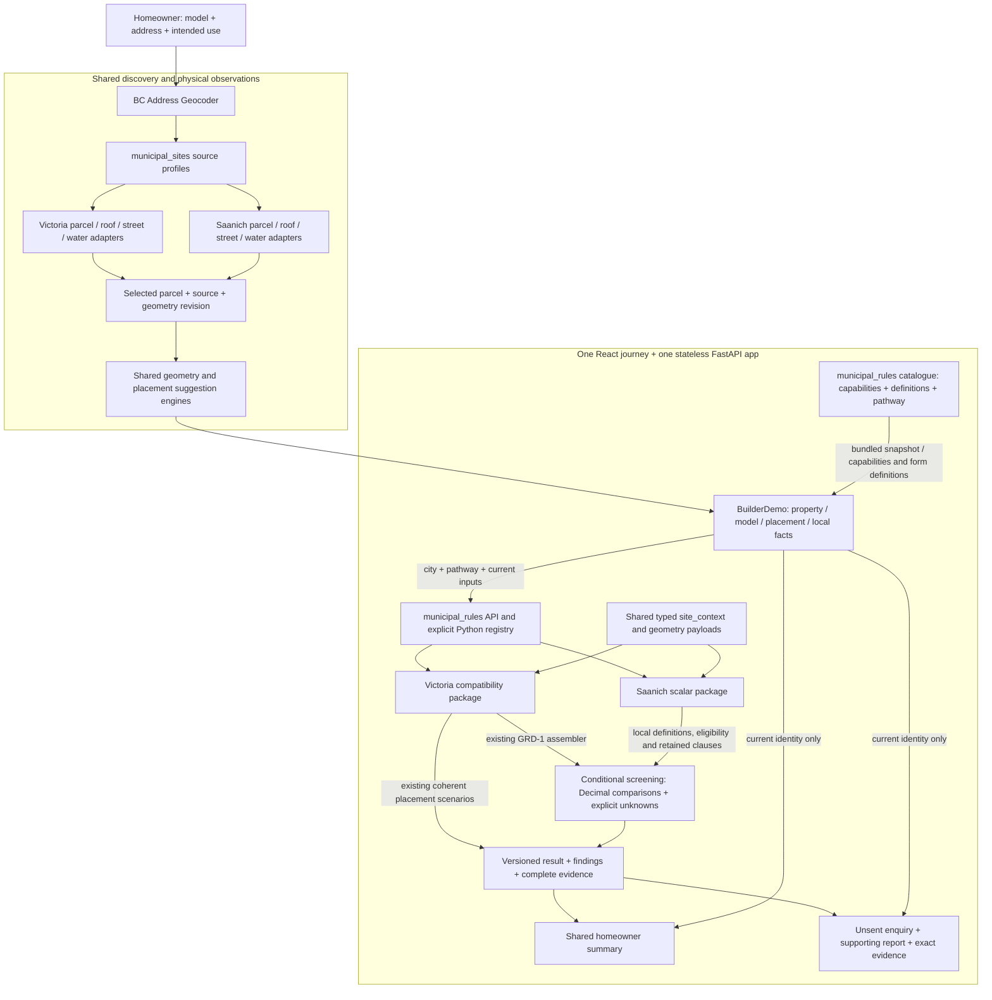
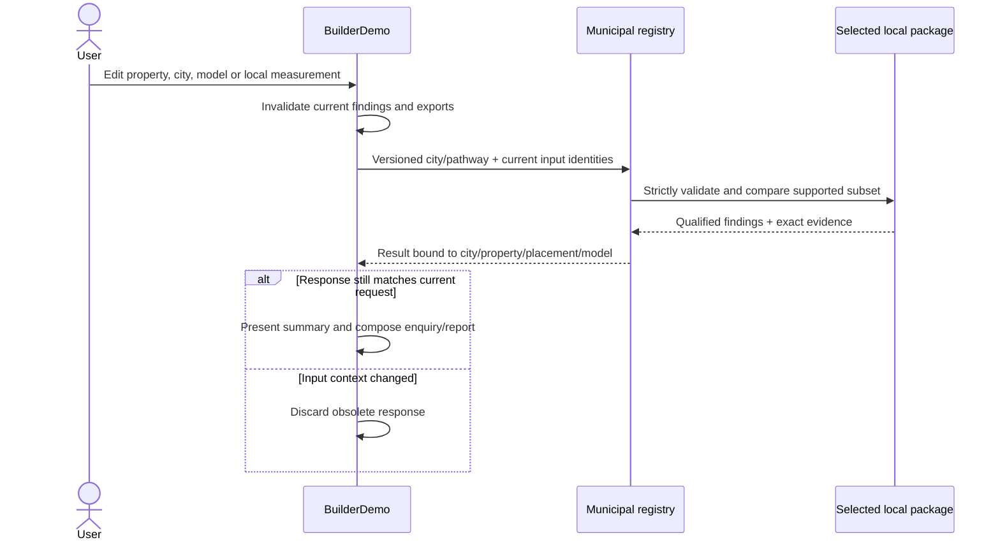

# Shared screening with city-specific meaning

The shared journey now evaluates Victoria or a bounded Saanich package without transferring one city's legal definitions into the other.

Implemented November 9, 2026. This is provisional screening for deciding what to
investigate and ask a provider. Code deployment does not publish accepted legal
data. The existing database/release pipeline remains separate and unchanged.

## What is shared and what remains local

| Component | Reused | City-specific responsibility |
|---|---|---|
| Address/property discovery | Selection, ambiguity, source attribution and geometry identity | Local parcel/building/street/water endpoints, schemas, rights and coverage |
| Geometry | Projection contract, polygon checks, occupied area, mapped gaps, placement suggestions | Suitable source CRS and interpretation of mapped features; geometric distance is not a legal setback |
| Site context | `conditional_screening/site_context.py`: buildings, boundaries, supplied facts and revision validation | Applicability of each fact to a local pathway |
| Rule catalogue | `municipal_rules/models.py`, `registry.py`; build-time frontend snapshot | Explicit package registration, capabilities, pathway, definitions and revision |
| Evaluation | Exact Decimal quantities, compatible dimensions/bases, status and evidence contracts | Thresholds, cumulative conditions, alternatives, exceptions and supported subset |
| UI | Model/property journey, map, current-result guards, findings and accessible definition help | Definition labels, source references, supported inputs; Victoria's existing controls stay in its compatibility branch |
| Communication | Shared summary, enquiry/report assembly, exports and provenance | Structured local findings, relevant next actions and omitted requirements |

`GET /api/municipal-rules/v1/catalogue` exposes the server catalogue.
`python -m app.municipal_rules` regenerates
`frontend/src/municipal_rules/catalogue.json`; `--check` detects drift, also tested
through the HTTP catalogue. The frontend derives city/parcel routing from that
snapshot. Map retrieval stays in `app/municipal_sites`, independently of legal
coverage; advertising a map capability does not establish a rule match.

`POST /api/municipal-rules/v1/evaluate` dispatches a versioned city/pathway envelope
to a strict local payload validator. The server selects the rules, never a
client-supplied expression or source URL. Its result includes package revision,
property/placement/model identities, findings, scope and original evidence.
`POST /api/municipal-rules/v1/placement-scenarios` dispatches only packages that
advertise that capability. Saanich does not advertise it.

The original `/api/conditional-screening/v1/*` Victoria endpoints remain compatible.
The new Victoria package delegates to the existing assembler and scenario engine;
it does not reinterpret their rules. Victoria's assembler still lives beside its
legacy HTTP adapter, and its bespoke presentation remains behind the compatibility
branch. Extract those further only when another supported pathway needs them.

## Saanich's implemented subset

| Comparison | Retained candidate threshold | Required meaning |
|---|---|---|
| Lot area | At least 400 m² | Saanich lot area; captured polygon is a disclosed approximate default, replaceable by an entry |
| Lot width | At least 12 m | Bylaw Lot Width, not a bounding-box dimension |
| Garden-suite floor area | At most 93 m² | Gross Floor Area (R), not Victoria interior floor area or the manufacturer's advertised footprint |
| Landscaped share | At least 45% | Open Site Space Requirement (GS) numerator divided by lot area; original percentage and definition retained |

These are implementations of the **unreviewed September 25 candidate capture** in
`municipality-transfer/saanich/rules/candidates.json`, not a new claim about the
current bylaw. The source snapshot, original quantities and ratio basis remain in
technical evidence; source/legal revision remains unknown. Inputs carry the
definition ID and revision. A different definition cannot gain a match. Percentage
conversion shifts the decimal exponent without losing supplied precision.

Zone permission, Sewer Service Area **or** Urban Containment Boundary, and an
existing single-family dwelling and the absence of an existing garden suite are separate findings. One true location branch
satisfies that provisional condition; two false branches conflict; false plus
unknown stays unknown. Missing eligibility facts leave useful scalar comparisons
visible within their stated scope. A known contradictory prerequisite or an
unsupported intended use withholds scalar matches.

Height/roof-linked setbacks, other siting, parcel/strata relationship,
overlays and servicing design are explicitly outside this subset. No Victoria
setbacks, property scan or fee reference is applied to Saanich.

## Changes and late responses

City changes clear local draft measurements. Property/model context prevents
transferring them into a different assessment. Correcting a Victoria parcel's
city to Saanich preserves its physical drawing but withholds local rules until
the source/city mismatch is resolved. Invalid numeric overrides clear the current
comparison rather than quietly restoring a favourable mapped default. Full
precision is used for evaluation; near-threshold rounded conflicts are labelled.

## Adding another city

1. Establish the decision and bounded pathway; retain attributed source clauses,
   definitions, revision/currentness limits and reuse rights.
2. Add or verify municipal source adapters and a suitable projected CRS. Keep
   unavailable geometry, building coverage and ambiguous parcel identity explicit.
3. Register an ordinary Python package with capabilities and local input models.
   Reuse scalar comparison only where dimensions and definitions match. Preserve
   coupled alternatives together; do not choose the best limit from each branch.
4. Generate the catalogue and extend an HTTP comparison case plus a real
   property-to-enquiry browser journey. Verify stale inputs and Victoria regression.
5. Deploy provisional capability separately from any reviewed-data acceptance or
   publication. Add new UI field types only when a concrete pathway requires them.

| Candidate city | Reuse now | Questions to resolve before implementing it |
|---|---|---|
| Squamish | BC address flow, physical placement, scalar core and enquiry | Acquire parcel/building sources and rights; identify the local suite pathway, definitions and any site-specific conditions that affect it |
| Vernon | Same shared components | Verify source completeness/CRS and actual legal definitions; choose a useful bounded subset rather than treating one city's garden-suite package as portable |
| Burnaby | Same shared components | Identify which development alternative applies; add coherent alternatives if needed, rather than assuming one pathway per municipality is sufficient |
| Calgary | Geometry contract, comparisons, journey and reports | Current address flow is BC-specific: add an Alberta-capable provider, jurisdiction/province routing and appropriate source projection; acquire Calgary rules/definitions independently |

These are onboarding questions and architectural limits, not researched claims
about those cities' current regulations. Only Victoria and Saanich are registered.
The present registry has **one supported pathway per city** and simple measurement /
boolean inputs. A city with multiple applicable pathways will need explicit pathway
selection and applicability handling; it should not be squeezed into Saanich's form.
Complex parcel topology can also exceed the current 64-edge site-context boundary;
test representative source parcels before expanding that contract or simplifying
geometry. Simplification must not silently change the basis of a legal measurement.
No queue, additional database, microservice or universal rule language is needed
for the demonstrated slice. Revisit storage/caching only with measured source
latency, traffic or a concrete persistence requirement.

## Verification and handoff

Recipient: homeowner preparing an initial provider conversation. The enquiry puts
local concerns before product questions, asks the provider for useful product
information, and leaves detailed municipal workings in the supporting report and
copyable exact evidence. No enquiry is sent automatically.

Software evidence: the public API tests compare every legacy/new Victoria result
and scenario field; verify the four Saanich thresholds, unknown/false eligibility,
definition mismatch, invalid geometry, unsupported city/pathway and catalogue drift.
The connected browser harness uses captured external map boundaries and real local
calculation APIs. It exercises both cities, exact percentage conversion, invalid
overrides, source/city mismatch, late responses, report/enquiry wording and phone /
desktop definition help. Run `npm run test:placement-demo --prefix frontend` with
`PLACEMENT_DEMO_URL` set to an isolated loopback production build. The existing
walkthrough harness covers the saved Victoria journey through the new endpoints.

Final check results and exact merged-revision verification are recorded in the PR
handoff. Browser captures are developer inspection, not homeowner validation.

Pre-merge local verification: 574 backend tests and 28 subtests passed; 37 database /
native-lifecycle cases skipped without isolated PostgreSQL. The 200-case frontend
suite, TypeScript/Vite production build, Ruff, catalogue drift and both connected
browser harnesses passed. Phone (390 × 844) and desktop (1280 × 900) Saanich inputs
and definition help were inspected; the Impeccable scan reported no findings in
the five changed UI targets. The enquiry inspection retained the near-threshold
lot-area concern and Saanich source status without Victoria rules or internal IDs.

| Remaining gap | Practical impact | Next owner/action |
|---|---|---|
| Saanich roof/height/siting and other excluded provisions | Four scalar comparisons cannot establish whole-project eligibility | Rules/product owner: select and source the next coherent pathway slice |
| Saanich zoning/service-boundary lookup and automated defined measurements | User-supplied facts or open questions remain; useful preliminary checks still run | Data/adapter owner: verify sources and implement bounded observations |
| Effective bylaw chain, independent interpretation and accepted release | No accepted legal evaluation or publication | Source/legal reviewer, then data-release owner through the existing acceptance process |
| Human comprehension, real-device and assistive-technology checks | Developer browser evidence does not establish usability | Product/research owner: observe a Saanich homeowner/provider conversation |
| Squamish, Vernon, Burnaby and Calgary | No local evaluations for those cities | Product/data owner: prioritize a city and answer the onboarding questions above |

The first two gaps limit demo coverage; the third blocks accepted legal evaluation.
They do not prevent a qualified Saanich assessment and unsent enquiry in this slice.
