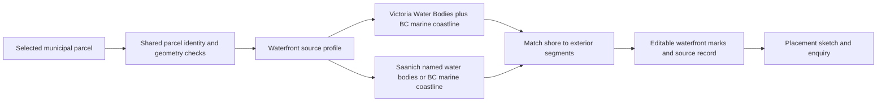

# Suggest physical shoreline contact on the selected parcel

The homeowner can keep the suggested edges, remove them, add a missing edge, toggle an adjoining run or choose **Not sure**. **Does the property adjoin water?** remains editable even when there are no suggestions. A positive match supplies a provisional waterfront scenario. A near contact that cannot be assigned to an edge leaves the answer unresolved. A clear search with no match or a lookup outage does not establish that the property is inland: the ordinary editable planning default remains labelled as an assumption.

| Parcel coverage | What can produce a suggestion | What it does not establish |
|---|---|---|
| Victoria | The shore of the City’s marine water polygon, with nearby provincial marine coastline as corroboration | Ponds, lakes and reservoirs are not evidence of tidal contact. The map does not establish the legal waterfront line. A positive observation takes ordinary Victoria setback comparisons out of scope. |
| Saanich | A close provincial marine coastline, or a shore of a named water body in the District’s inventory (for example, Prospect Lake) | Physical shoreline only. Unnamed water bodies and watercourses are outside the inland lookup. Saanich zoning checks remain unavailable. |

Sources: [Victoria Water Bodies](https://maps.victoria.ca/server/rest/services/OpenData/OpenData_Environment/MapServer/5), [District of Saanich Waterbody catalogue and licence](https://www.arcgis.com/home/item.html?id=1c70a28153e643a7ae568653247b55b6), [GeoBC Freshwater Atlas – Coastlines and licence](https://open.canada.ca/data/dataset/87b1d6a7-d4d1-4c25-a879-233becdbffed). Each response carries provider attribution, licence, query URL, feature identifiers, capture time and original response evidence. Capture time is not a survey date.

`POST /api/municipal-sites/waterfront-edges` takes the same versioned parcel reference and optional PID as [street prefill](municipal-street-prefill.md). Both use the municipal source registry, parcel identity and ordered geometry checks, and the same cancellable client lookup. The waterfront profile registers the marine line, whether it can suggest an edge directly, and the polygon layers and name fields used for corroboration or named inland water. Each capability has its own endpoint and matcher, so a street-source outage does not prevent waterfront suggestions. A failed Saanich shoreline source can still leave suggestions from the other one.

The matcher checks the outer ring in projected metres. At 20%, 50% and 80% along a segment, the same shoreline must be within 3 m and run within 40° of the parcel side. For water polygons it also checks that an outward point falls in water and an inward point falls on land. Nearby parcels block marks across intervening mapped land. Victoria additionally requires a marine coastline within 12 m of the local water outline. The polygons are generalized to 0.5 m to bound the size of a citywide water feature. These are map-matching tolerances, not setbacks or a legal minimum contact length. The shared matcher supports single polygons with at most 64 exterior segments. Unsupported geometry gets no prefill; a separate manual sketch remains available.

A homeowner edit takes precedence over incoming suggestions for the current parcel. A changed parcel cannot reuse edge marks. Moving the unit does not change the shoreline. Removing and re-adding an edge records the new mark as the homeowner’s input. Technical evidence retains the original observation separately from the active selection. The enquiry and sketch describe the current marks.

**Verification, November 6, 2026.** A live address-to-map browser check removed, re-added and cleared marks at 1765 Hollywood Cres (four marine segments), 1181 Portage Rd (12 marine segments), and 5015 Prospect Lake Rd (four lake segments). Live queries also returned no match for Victoria’s Dallas Road comparison parcel 12740 and the Saanich inland-side parcel at 4900 Cordova Bay Rd; 5079 Prospect Lake Rd returned uncertain contact without preselecting an edge. The offline [HTTP geometry cases](../tests/test_municipal_waterfront.py) exercise an intervening strip, an 8 m gap, freshwater versus marine context, a stale parcel identity, source loss and partial coverage. The [browser journey](../frontend/tools/placement_demo_browser.mjs) replays the Prospect Lake case; its fixture omits duplicate raw upstream responses, retaining observation geometry, capture identity, attribution and source locators.

**Remaining evidence.** These checks verify the software and selected live map observations. They do not measure citywide accuracy or homeowner effort. The product/data owner should independently label coastal, freshwater, separated and ambiguous parcels in each municipality, then measure wrong marks, misses and correction time before widening the tolerances or enabling another source profile. Where a decision depends on the legal shoreline or special siting rules, the property contact and local reviewer need the applicable plan and rules.
