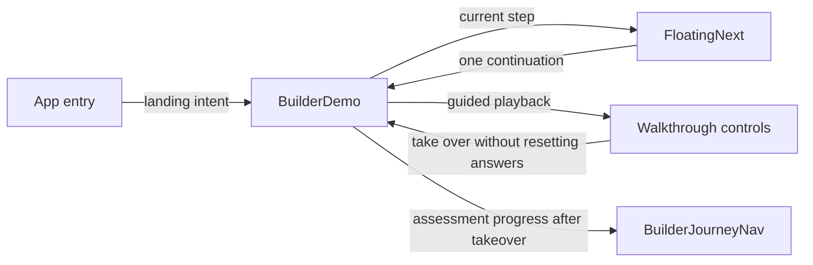

# Homeowner navigation reliability



November 9, 2026. This integration follows the current-flow Impeccable review of
`5ec2251`. It repairs navigation around the existing scouting workflow; it does
not change calculations, accepted sources, or the meaning of workflow completion.

## Decisions

Keep one continuation control in the active step's layout. Its position must not
depend on measuring a wrapper whose size changes when the control docks. The
review reproduced repeated docking at a stationary scroll position on both
Property details and Intended purpose, including with reduced motion enabled.
Native sticky positioning retains layout space and avoids that feedback loop.

Make continuation depend on the active task rather than whether the map SVG is
visible. Phone boundary controls can occupy the screen while the map is below it.
The action must remain reachable from those controls, with enough space to reach
the last input without the action covering it. Preserve the existing ability to
continue with unanswered questions.

Keep demo controls stable during asynchronous checks. Waiting must prevent
advancement without dropping keyboard focus. Put wrapping narration after the
action row and use the actual player height when bringing a destination into
view. The guided demo shows its own progress; the full assessment rail returns
when the visitor takes over the same assessment.

Treat entry focus as part of the selected task. A fresh property assessment should
reveal the address input, while an explicit model link should reveal the model.
Reopening an existing assessment must retain its compatible state and progress.
Switching between address and manual entry should expose and focus the new form
without discarding partially entered text merely because its view changed.

Use an immediate destination scroll for journey steps. Combined browser testing
found that the page's smooth top reset could compete with a smooth placement
scroll, leaving focus on an offscreen heading. Step navigation now reveals its
focused destination immediately; Intended purpose no longer requests a second
competing scroll. Other in-page summary links retain their existing motion policy.

## Ownership and integration

Three isolated workers own continuation/layout, demo controls/progress, and
property entry/focus. The demo and entry workers explicitly share disjoint
BuilderDemo host hunks; the coordinator reconciles them in one integration branch.
The coordinator owns this record, the central quality note, combined checks and
the PR. Workers do not independently merge overlapping host changes.

## Verification

The TypeScript/Vite production build and all 200 frontend tests pass on `709f8e8`.
The navigation fixtures now supply both animation-frame functions and
wait for committed focus work instead of relying on a short sleep. The real
browser regression is necessary because jsdom cannot reproduce sticky geometry.

Run from `frontend/` against a stateless production preview on port 18089:

```powershell
npm test
npm run build
$env:WALKTHROUGH_BROWSER='chrome'
$env:CONTINUATION_URL='http://127.0.0.1:18089'
node tools/continuation_browser.mjs
$env:WALKTHROUGH_URL=$env:CONTINUATION_URL
$env:WALKTHROUGH_API=$env:CONTINUATION_URL
node tools/walkthrough_browser.mjs
$env:PLACEMENT_DEMO_URL=$env:CONTINUATION_URL
node tools/placement_demo_browser.mjs
$env:COMPARISON_URL=$env:CONTINUATION_URL
$env:COMPARISON_API=$env:CONTINUATION_URL
$env:RENTAL_ACCEPTANCE='1'
node tools/verify_financial_integration.mjs
```

The combined browser run reproduced the original entry-scroll failure before
the correction and passed afterward. At 390 × 844 and 1440 × 900, normal and
reduced motion, the continuation check holds five positions around both Property
details and Intended purpose handoffs and asserts unchanged button bounds and
document height. It hit-tests Next before automation can scroll it into view,
reaches phone Boundaries with the map offscreen, reveals a focused input covered
by the footer, and advances through economics to enquiry exactly once per action.
The final `709f8e8` run passed all four viewport/motion combinations. Phone
Boundaries, Property details and Intended purpose share a 272 px footer, with
labels using no more than two lines and no horizontal overflow. Retained evidence:
[results](usability/navigation-reliability-2026-11-09/continuation.json),
[phone property details](usability/navigation-reliability-2026-11-09/phone-details.png),
and [phone intended purpose](usability/navigation-reliability-2026-11-09/phone-purpose.png).

The guided-demo run on `bd6a819` verified identical Next bounds during waiting and
readiness, blocked early activation, destination headings, takeover focus, the
restored assessment rail, failure/retry and obsolete-response rejection. The
placement suite passed captured Victoria/Saanich discovery against real local
calculation APIs. Entry checks passed 20 focus/visibility observations on desktop
and an emulated phone, including manual/address round trips and preserved drafts;
they were repeated after the scroll correction.

The first four-model financial run passed phone/desktop × include/skip, but its
last contexts overlapped the scroll-fix rebuild. It is mixed-build evidence, not
an exact-final-revision claim. Exact merged-revision Sol verification and a fresh
independent Impeccable review follow merge. CI and those post-merge results are
recorded in the PR/handoff rather than inferred from earlier worker results.

Local premerge logs and screenshots are under `.local/navigation-verification/`
in the integration checkout. No database, provider contact or submission was used.

## Remaining evidence

Browser automation establishes behavior at the tested viewport sizes. It does
not establish physical-phone virtual-keyboard behavior, actual screen-reader
speech or homeowner comprehension. Engineering owns device and assistive-
technology follow-up; Quinn/product research owns homeowner sessions. Source
review and accepted-data publication remain independent of this navigation work.
