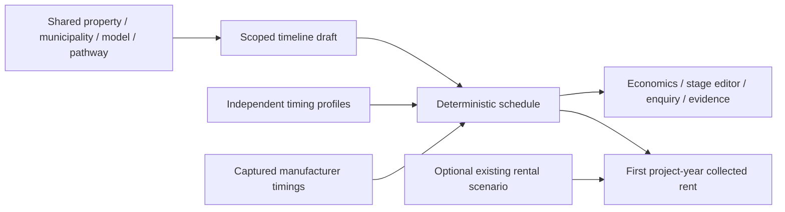

# Location-aware project timeline

Implemented November 9, 2026 for preliminary exploration and discovery-call
preparation. The timeline shares attributed municipality context with the
homeowner journey; its profile registry does not consult mapping or zoning
coverage. No API, database, accepted-data publication or provider contact is added.
Reloading clears in-session drafts; the existing downloadable technical evidence
preserves them. Timeline import/restoration is not implemented.

## Schedule and assumptions

Preparation, permits, production, site work, installation and completion have
editable calendar-week bounds. Blank, reversed or malformed ranges leave
readiness unestimated. Zero is an explicit user allowance, never missing data.

For a contract-to-delivery bundle, with `P` preparation, `A` additional approvals,
`B` building-permit period, `M` manufacturer bundle, `S` site work, `I` installation
and `C` completion: `ready = P + max(M, A + B + S) + I + C`.

The purchase contract is assumed signed after preparation. Permits and site work
can constrain delivery, but are not added to a bundle covering that same period.
Production after permits uses `P + A + B + max(M, S) + I + C`; production alongside
permits uses the first expression with a production-only duration. Changing
manufacturer scope clears the old production override. This is a small fixed
dependency calculation, not a general scheduling engine or statistical forecast.

Site work starts after issuance. Installation waits for both the unit and site.
Completion allows for final connections, inspections, corrections and occupancy
authorization. Delivery is never occupancy permission. Additional approvals can
be allowed before the building-permit application; the default building-permit-only
scenario does not determine which approvals the property requires.

An undecided use can explore this disclosed residential scenario. An explicitly
different use (for example, Home office) cannot apply the residential municipal
target: the permit stage falls back to the editable 6–16-week allowance. The
captured profile remains reference evidence, without contributing to that result.

| Allowance | Starting range | Basis |
|---|---|---|
| Preparation | 2–6 weeks | Illustrative discovery, site information, design and complete application |
| Permit issuance | Published target + 2–8 weeks | Five-business-day week conversion plus illustrative revisions/issuance allowance; no holiday calendar |
| Uncovered municipal permit timing | 6–16 weeks | Labelled assumption; no borrowed city target |
| Manufacturer timing without an applicable bounded claim | 16–28 weeks | Labelled assumption; qualitative earliest claims cannot become bounded ranges |
| Site work | 2–6 weeks | Foundation/services; major upgrades need an edit |
| Installation | 1–7 days | Delivery coordination and installation, separate from occupancy |
| Completion | 2–4 weeks | Connections, inspections/corrections and occupancy authorization |
| Additional approvals, when selected | 4–16 weeks | Illustrative starting allowance; replace with local advice |

These are disclosed choices, not measured local completion distributions. All
original manufacturer claims, units, sources and qualifications remain in evidence
when overridden. A missing upper bound is not treated as an exact duration.

## Source profiles

The municipal sources were opened independently on November 9, 2026. Neither
supplies a project-specific issuance/occupancy date. Publication dates are not
supplied; the unreviewed profiles are revisioned by capture date.

| Profile | Meaning and treatment |
|---|---|
| [City of Victoria: single family / duplex eApply](https://tender.victoria.ca/WebApps/eApply/Prospero/Dashboard/Template/Welcome.aspx?TemplateName=SFD%2FDUPLEX+BUILDING+PERMIT) | Review targets are 7 or 20 business days by scope; most are 20. Complete-application acceptance starts the clock. Use 20 as a disclosed residential proxy, not a garden-suite issuance commitment; revisions/issuance have their own allowance. |
| [District of Saanich: Inspection Services](https://www.saanich.ca/EN/main/local-government/inspections-services.html) | Complete residential submissions have a 12-business-day initial-response target. The response may contain requests or departmental comments. Garden suites are in this residential category. Response remains distinct from issuance. |
| [aux box FAQ](https://www.auxbox.ca/faqs) | Provider-wide 12–18 weeks from contract to delivery, dependent on model, production schedule and permits. Reuse the captured catalogue claim and original capture identity. The November 9 web check corroborates the interval, not Model 300 availability. |

Current [Victoria building guidance](https://www.victoria.ca/building-business/permits-development-construction/building-renovating)
requires resolving preceding rezoning/development permits before building permits.
No universal additional-approval requirement is inferred from old garden-suite
guides. Ask the municipality which approvals apply to the property; the separate
allowance supports planning without determining legal applicability.

## Context, rental and handoff

Property, attributed municipality, model/revision/snapshot, configuration and
project pathway identify the draft. Changes create fresh defaults synchronously
for display/export and retain prior drafts as inactive technical evidence. Returning
to an old model/location cannot reactivate stale overrides. Timeline permit-pathway
changes clear the permit override; manufacturer-scope changes clear production.

Skipping rental income leaves the full timeline accessible in both economics
views. Optional first-project-year rent uses the existing rent/vacancy assumptions,
prorated by days between estimated readiness and the start-date anniversary.
February 29 anniversaries clamp to February 28. Partial readiness days round up;
completion after the first year yields zero rent. Missing timing/rent/vacancy yields
no estimate. The figure excludes expenses, financing and tax and assumes no extra
letting delay. Existing annual economics remains a stabilized full rental year.

Provider enquiries get a short scenario and request to confirm timing, without
rental finances. Supporting homeowner reports include stages, assumptions, sources
and optional first-year rent. Technical exports preserve full current and inactive
draft evidence. This is agent composition review, not recipient comprehension testing.

## Verification and remaining work

Starting base: `46815e26d5b3aaa3ebfd9bf40e4d9ad9154f8248` (main / shared municipal
screening). Five integration/calculation tests exercise captured inputs through
schedule, rendered disclosure and enquiry export. Independently specified examples
protect overlap, unknown propagation and calendar-year rent arithmetic.

From the repository root: `npm test --prefix frontend`, `npm run build --prefix
frontend`, `git diff --check`. For browser checks, build and start
`uv run --locked python -m uvicorn app.main:create_app --factory --host 127.0.0.1
--port 8046` with `SHOVELREADY_ENV=demo`; from `frontend`, run
`node tools/timeline_browser.mjs`. External sources are isolated; real local
geometry/municipal APIs run without a database. Phone/desktop journeys cover rental
include/skip, overlap/serial schedules, missing/reversed bounds, context changes
and evidence retention. Final-head CI, Impeccable review and merged-revision Sol
verification are separate evidence in the integration PR and review record.

Local results: 205/205 frontend tests passed; TypeScript/Vite build passed with
existing bundle-size/dynamic-import advisories. The dedicated phone/desktop
timeline runner passed, with no page errors. [Impeccable review](usability/project-timeline-2026-11-09/README.md)
completed independently, then confirmed all three corrections (31/40, Good).

Sol's exact-merge check of `6d02cdc` passed those 205 tests and both timeline
journeys, then reproduced a gap in a downloaded Saanich Home office report: a
reset draft still used the residential 12-business-day target. The follow-up adds
explicit proposed-use applicability and a sixth regression example, plus a
normal-journey office/garden-suite switch. Reports now also identify a permit
override as replacing the target-derived allowance, while preserving the source.
The follow-up PR records final CI and Sol verification of its merged revision.

Remaining gaps and owners:

- Municipal staff/property contact: confirm the actual permit route and current
  issuance expectation before scheduling commitments; review targets alone cannot.
- Manufacturer: confirm current model/configuration, slot and bundled scope;
  unsupported or unbounded timing uses editable assumptions.
- Contractor/municipality: replace site/completion allowances before booking work;
  no accepted occupancy assessment is produced.
- Quinn/product research: homeowner comprehension remains unmeasured. Engineering:
  physical-device and actual screen-reader checks remain separate from browser QA.
- Durable editing: evidence exports preserve work, but reload restoration/import
  of timeline drafts is outside this implementation.
