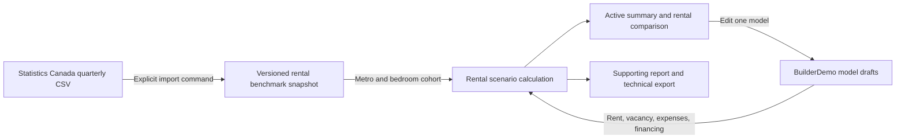

# Rental scenarios use regional evidence and keep each model's assumptions

Implemented November 8, 2026 (Vancouver). This adds a useful provisional rental
scenario to the existing cost comparison. It is a full stabilized rental year,
not a forecast of the first construction/lease-up year, a permit determination,
appraisal or return ranking. No new service, database or runtime model call is used.

## Starting assumptions and edits

Choosing potential rental income shows a prefilled scenario and an income
comparison for every explored model. Skipping the question preserves the cost
comparison and enquiry; people can revisit financial interests later.

The catalogue descriptions identify Model 300 and Quadra 4 as one-bedroom and
Model 240 and C.H. Studio Pod as studio layouts. Those select the corresponding
regional apartment cohort. The user can change both the market and layout. The
chosen configuration's suitability for a self-contained long-term dwelling still
needs investigation, and the existing material suitability findings remain visible.

Victoria, Saanich, Langford and Oak Bay map to Victoria CMA; exact other metro names
can also match. No regional fallback is inferred from an unknown locality, a BC
address alone, or a broad CRD location. All 42 available metropolitan areas are
selectable. Missing/suppressed cohorts produce no rent; a user can enter their own.

The November 8 import has Q2 2026 Victoria apartment asking rents of CAD 1,670/month
for studios and CAD 2,040/month for one-bedroom units. Values are sourced starting
assumptions for exploration. We apply no invented size premium, discount or band.
Only published interior area is identified; exterior footprint never becomes
rentable area. Identical cohort assumptions can produce identical rental outcomes
across different models. These are apartment proxies, not suite comparables.

Vacancy starts at 5% (about 18 days/year) and running costs at 25% of rent after
vacancy. These are explicitly illustrative product planning allowances, not local
observations or professional estimates. They are displayed beside the affected
income and can be replaced or cleared. Running costs should include incremental
property tax, insurance, owner-paid utilities, management, maintenance and
replacement reserves. The homeowner can instead enter a total monthly expense.
Financing is initially unknown, with an explicit no-borrowing choice or monthly
principal-and-interest payment input. No unsupplied cost becomes zero.

For each model, edits survive model switching and changes to financial interests
within the open assessment. Choosing a different benchmark market/layout explicitly
restores the rent from that cohort; the restore button removes a rent override.
Starting another property resets the drafts. This does not add reload persistence.

## Calculations and evidence

- Annual rent before vacancy = monthly rent × 12.
- Collected rent = annual rent × (1 − vacancy percentage / 100).
- Running costs = collected rent × expense percentage / 100, or monthly expense × 12.
- Income after running costs = collected rent − running costs (including reserves).
- Cash flow before income tax = income after running costs − monthly debt payment × 12.

Negative cash flow is preserved. Blank/invalid required inputs withhold dependent
results; explicit zero remains valid. Values calculate at full precision and money
is displayed rounded to whole CAD. Annual operating income and debt cash flow remain
distinct; no purchase/installed-cost return, appreciation, tax or rent growth is added.
The existing cost totals still require matching scope and currency.

The supporting homeowner report includes the scenario, source, adjustments and
qualifications. The technical record includes the draft, computed outputs, source
hash, vector, period and capture date. The manufacturer's quote enquiry does not
automatically disclose the homeowner's rental income or debt assumptions. Exported
evidence preserves the original calculation and source even after a later import.

## Updating the benchmark

Run `python tools/import_rental_benchmarks.py` from the repository root, or pass
`--csv path/to/46100092.csv` for a previously downloaded official CSV. The command
uses StatCan's documented download endpoint, selects the latest quarter's apartment
asking-rent cohorts, preserves unavailable observations and writes
`frontend/src/rental_scenario/benchmarks.json` only after validation succeeds. It
does not run in normal startup or CI. Review the generated diff before committing;
this observational reference bundle is separate from accepted regulatory publication.

Source: Statistics Canada, Table 46-10-0092-01, second quarter 2026.
Reproduced and distributed on an as is basis with the permission of Statistics Canada.
[Table](https://www150.statcan.gc.ca/t1/tbl1/en/tv.action?pid=4610009201) ·
[methodology](https://www150.statcan.gc.ca/n1/pub/46-28-0001/2025001/article/00004-eng.htm) ·
[open licence](https://www.statcan.gc.ca/en/terms-conditions/open-licence).
Asking rents are not signed leases; incentives and differences in utilities,
furnishings and parking affect comparability. The bundled capture date is UTC.

## Verification and remaining work

`npm test` passed 200 frontend cases, including independently calculated rental
arithmetic, missing/invalid values, 100% vacancy, negative cash flow, unsupported
geography and supporting-report provenance. TypeScript and Vite build passed.
The importer passes Ruff; Impeccable's mechanical scan reported no findings on
the changed UI. Browser evidence is recorded in the integration handoff.

| Remaining work | Practical impact | Next owner/action |
| --- | --- | --- |
| Comparable small-suite rent data and measured expenses | Current numbers are editable metro-apartment scenarios, not forecasts for these suites | Rental data/product owner: investigate permitted local comparables and calibrate layout/size adjustments |
| Matching installed quotes, site scope and borrowing terms | Cash flow is a scenario; installed-cost returns remain unavailable | Homeowner/provider/lender under #124/#125 |
| Homeowner understanding and usefulness | Software checks do not establish which metric helps a real contact decision | Product research #340/#16/#147 |
| Reload recovery, physical devices and assistive technology | Drafts stay in the open assessment; browser emulation is limited | Product/QA owners to scope persistence and real-device checks |
| Independent legal/source review and accepted publication | Rental economics do not establish permissible residential use | Existing source/publication owners |
