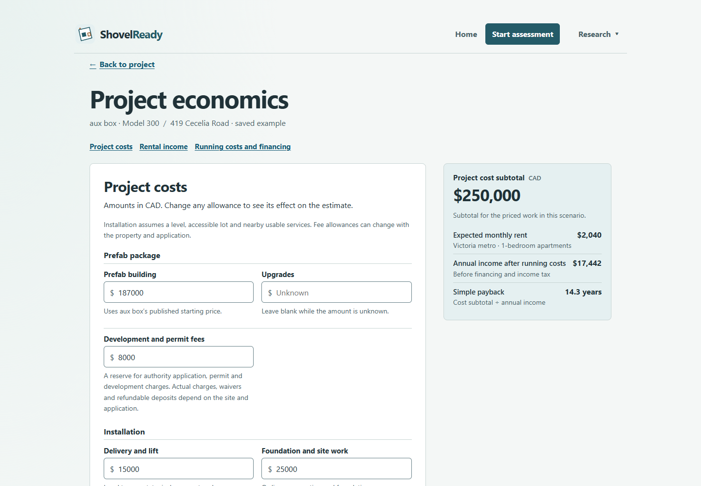
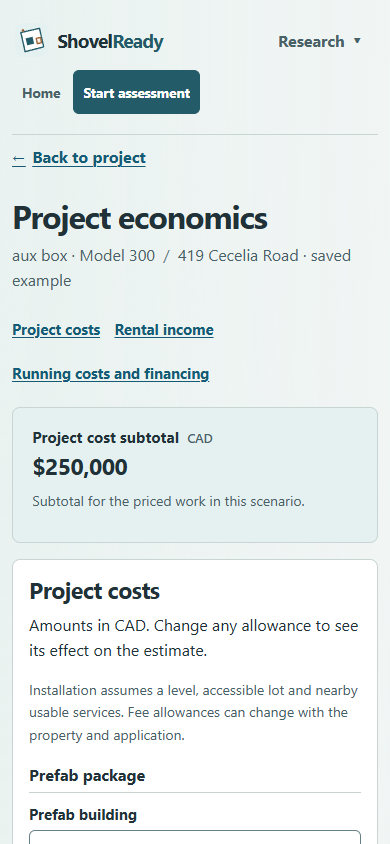

# Economics labels, accessible updates and owner walkthrough

Follow-up to [the project economics review](../project-economics-2026-11-09/README.md),
November 9, 2026. The expanded editor now shows the single fee label once and
distinguishes the prefab package group from its building-price field. CAD remains
programmatically associated with cost inputs. The visual hierarchy and calculation
definitions are unchanged.

One persistent, visually hidden polite status replaces the desktop-only live
aside. Settled edits announce changed results, including negative and unknown
values, without moving focus or reading source paragraphs. Malformed edits cancel
pending affected updates; correcting the same accepted value resumes the update.
The ordinary visible panels remain available to browse on both screen sizes.

[Implementation and verification](implementation-verification.md) distinguishes
Chrome accessibility-tree and text-mutation evidence from actual screen-reader
speech. Desktop and phone captures were inspected together; no further visual
redesign was introduced.

The [browser record](browser-evidence.json) contains the ten matching settled
status updates at each width and four completed include/skip runs across four
models, with no page errors or external requests. The implementation working
tree passed all 200 frontend tests, production build and advanced budget checks;
the two-file Impeccable scan returned no findings.

## Owner walkthrough

The product owner volunteered to try the flow. The first task was supplied in
chat against public application/frontend commit
`86ec21167757d70f00775c1929aaebf71eea3ece`, verified through `/api/identity`.
This phase asks what stands out, what the cost/income mean and the next action;
the main summary is unchanged by this follow-up. The editing task will use the
updated deployment. Record the phases separately if they use different builds.

No participant task response had been received when this kit was prepared. The
exercise is pending, not passed. The [participant tasks](participant-tasks.md)
and [facilitator guide](facilitator.md) make it runnable without revealing expected
answers in the participant prompts. Prior exposure and product-owner involvement
limit what this self-test can establish about new homeowners.

## Remaining evidence

- Actual VoiceOver/TalkBack/Narrator output needs a real assistive-technology
  session; Chrome's accessible tree and live-text transitions do not prove speech.
  Accessibility QA owns that check using the implementation record's procedure.
- Participant responses are needed before a keep/revise decision about financial
  prominence. The owner is the next participant; broader homeowner sampling and
  alternate-presentation research remain under #340/#16/#147.
- Provider quotes, applicable fees/taxes, suite comparables, resale estimates and
  accepted source/legal review remain separate from this UI improvement.
