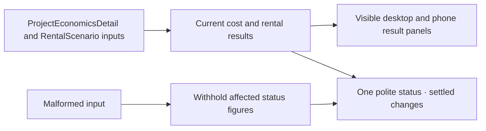

# Project economics accessibility follow-up

The [previous review](../project-economics-2026-11-09/confirmation.md) found that
the phone rental figures sat outside the desktop live region. The editor now
keeps a single status available at either width. It starts empty and announces
changed figures after 700 ms of settled results. The editor presents the
calculation and sources for on-demand reading. A malformed edit suppresses the
affected pending announcement. An accepted blank can announce that a figure
is no longer estimated.

The project cost editor uses one **Development and permit fees** label and
a **Prefab package** group for the building and upgrades. Quick-cost input
descriptions include CAD and field-specific help. Overlapping, ranged and
other detailed entries lead to the detailed cost editor.

## Software verification

The checks used the implementation working tree based on `86ec211`, later
committed as `26fa953`. The browser log captured the base Git commit because
the run began before the commit. The served production asset was
`/assets/index-DdKjHp6d.js` with SHA-256
`5178420254762c4c0251e5a0054147a07f2029abda1f8a338dd6eb6eb8d77478`.

| Check | Observation |
|---|---|
| `npm run build` and `npm test` | Production build passed with the existing Vite chunk warnings. All 200 frontend cases passed. |
| Impeccable 4.3.1 | One scan of the two changed product files returned zero findings. |
| Chrome 156.0.8078.80 accessibility tree | One exposed polite, atomic status and one exposed expected-rent label at each width. The fee control had one accessible name and a connected CAD description. |
| Browser status text and focus | Ten matching settled updates at 390 × 844 and 1440 × 1000. Rapid rent entry produced one update. The invalid fee edit stayed quiet and correcting it to the same accepted value announced the result. Malformed rent stayed quiet. Clearing fees, rent and debt payments made the affected results unavailable. The status distinguished a negative operating result from negative cash flow after debt payments. Editing focus stayed in the field. |
| Four-model acceptance | Sixteen model visits completed across phone and desktop with rental included and skipped. The local run covered estimate return, retained model inputs, comparison, enquiry and the report/evidence package, with zero page errors and external requests. |
| Advanced cost browser check | Keyboard entry, overlapping import handoff, cost evidence downloads, draft recovery and desktop/mobile layout passed. |

From `frontend/`, run `npm run build` and `npm test`. Start the stateless
app with `SHOVELREADY_ENV=demo` and
`python -m uvicorn app.main:app --host 127.0.0.1 --port 18081` from the
repository root. Set `COMPARISON_URL` and `COMPARISON_API` to that loopback
origin and `RENTAL_ACCEPTANCE=1`, then run
`node tools/verify_financial_integration.mjs` from `frontend/`.
The existing harness checks browser accessibility-tree properties through
Chrome DevTools Protocol and records text changes in the status. It blocks
external requests and uses the local stateless API.

Set `WALKTHROUGH_URL` and `WALKTHROUGH_API` to the same origin and
`WALKTHROUGH_BROWSER=chrome`, then run `node tools/budget_browser.mjs`
for the advanced cost case.

## Physical screen-reader check

The browser checks establish accessibility-tree exposure and status text
changes in Chrome. This environment did not capture Windows Narrator speech
and had no physical mobile assistive-technology session. VoiceOver and
TalkBack delivery, timing, interruption and currency pronunciation remain
open. Accessibility QA can run this check against the same deployed revision
on iOS Safari with VoiceOver and Android Chrome with TalkBack.

1. Open the saved Model 300 example in a new tab, include rental income and
   open **View and adjust estimate**. Check that the heading receives focus
   and the status starts quietly. Read the fees field and check its single
   label and CAD unit.
2. Enter `9000` in **Development and permit fees** and pause for a second.
   Listen for one update giving the CAD 251,000 subtotal and 14.4-year payback
   on priced costs. Enter `9x`, pause, then correct it to `9000`. Confirm the
   invalid edit produces no new estimate and the accepted amount remains.
3. Enter `2400` in **Monthly rent (CAD)** without pausing between digits.
   With the new fee and the starting allowances, listen for CAD 2,400 monthly
   rent, CAD 20,520 annual income after running costs and 12.2 years on priced
   costs. Clear the rent and confirm the status announces unavailable results.
   Use **Use regional rent again** to restore the starting rent.
4. Choose **My total monthly running costs** and enter `2000`. Listen for
   CAD 24,000 annual running costs, negative CAD 744 annual operating income
   and unavailable payback. Restore the 25% running-cost allowance. Choose
   **Enter monthly debt payments** and enter `3000`. Listen for negative
   CAD 18,558 annual cash flow after debt payments. Clear the payment and
   listen for unavailable cash flow.
5. Check that editing focus stays in place, that detailed figures remain
   readable by navigation, and that **Back to project** returns to the opener.
   Record the build identity, device, OS, browser, screen reader and what
   was spoken. Record any silent, repeated, interrupted or out-of-date result.

This is a product accessibility check using the saved scenario. The separate
[comprehension exercise](participant-tasks.md) measures how a person reads the
summary and chooses a next step. Source review and accepted evaluation remain
separate from both.
