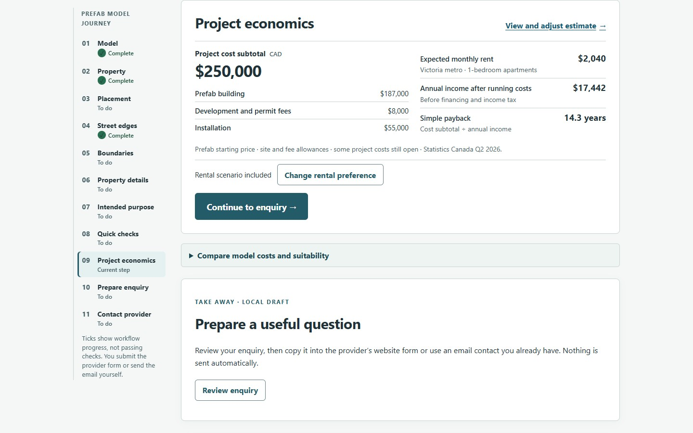
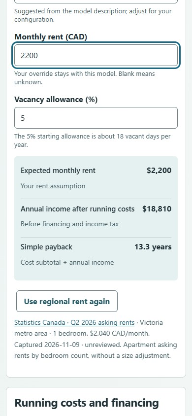

Method: dual-agent (A: economics_review_a · B: economics_review_b)

# Project economics visual review

The compact estimate feels specific to ShovelReady: it connects a selected prefab,
site installation and local rental assumptions to the next provider conversation.
It preserves Civic Atlas typography and colours. The dedicated editor keeps the
main assessment readable while allowing the homeowner to inspect and change the
calculation. The unused spending-preference field and duplicate rental editor are
removed.

The independent first assessment scored **27/40**. After one correction batch,
the bounded desktop and phone confirmation scored **31/40 — Good**. There were
no material blockers in the tested visual and keyboard flow. This is agent review,
not a homeowner study or a full accessibility audit.

| Heuristic | Score | Confirmed behaviour or remaining limit |
|---|---:|---|
| System status | 3 | Updated rental results remain beside phone inputs. |
| Match with the real world | 3 | Cost scope and metro apartment benchmark are named. |
| Control and freedom | 3 | Skip/revise and return preserve valid model edits. |
| Consistency and standards | 3 | Native controls, shared tokens and predictable focus. |
| Error prevention | 3 | Grouped amounts work; malformed edits preserve valid costs. |
| Recognition rather than recall | 4 | Section links and nearby results reduce memory work. |
| Flexibility and efficiency | 3 | Keyboard navigation and direct amount adjustments. |
| Aesthetic and minimalist design | 3 | Compact cost split and more prominent income figures. |
| Error recovery | 3 | Inline guidance explains why an edit was not applied. |
| Help and documentation | 3 | Sources and assumptions are available in the editor. |
| **Total** | **31/40** | **Good** |

## Strengths and corrected findings

- The summary makes project cost, monthly rent, annual income after running costs
  and scoped payback readable together. Cost remains the anchor while rental
  figures have greater numerical emphasis.
- One shared draft drives both views. Valid fee and rent edits update both, and
  Back to project restores the originating link and scroll position.
- Rental remains optional. Skipping retains the cost estimate and enquiry path;
  including it later opens the new controls with keyboard focus.

The review found four actionable issues, corrected before the confirmation:

1. **P1, corrected:** malformed cost input wrote Unknown over a valid amount.
   Valid comma grouping is now accepted; other malformed nonblank edits leave the
   last valid amount in use and explain that inline. Deliberate clearing still
   means unknown. Appropriate Impeccable action: harden.
2. **P2, corrected:** the headline rent basis omitted the benchmark population.
   It now names the metro apartment cohort. Appropriate action: clarify.
3. **P2, corrected:** including rental from the editor dropped focus to the page
   body. It now focuses the Rental income heading. Appropriate action: harden.
4. **P2, corrected:** phone rental inputs were more than two screens below the
   live result. Section links and nearby updated figures remove that separation.
   Appropriate action: adapt.

Parent code review also protected multiple imported cost entries from a misleading
single-value quick edit and corrected currency labels. These are covered by the
implementation's regression checks rather than inferred from visual appearance.

## Cognitive load and personas

The summary has one main editing link, a reversible rental choice and collapsed
comparison/evidence. Editor groups keep related decisions together. The full
market list stays inside a native select. The existing eleven-step desktop journey
rail is outside the editor and was not redesigned.

For a first-time homeowner, the concrete starting estimate supports deciding
whether to investigate. For a keyboard user, entry, rental inclusion and return
now move focus predictably. For a phone user, the rent input and changed annual
income/payback fit in the same viewport. Real homeowner comprehension and mobile
screen-reader announcement behaviour remain untested.

## Evidence and scope

[Independent design assessment](design-review.md) ·
[Independent detector/browser assessment](detector-review.md) ·
[Correction confirmation](confirmation.md) ·
[Measured confirmation results](confirmation-browser.json)

A and B used separate native browser tabs, without sharing findings. A completed
before B's detector output entered parent synthesis. Impeccable scanned seven
changed markup files once: **zero findings or advisories** ([JSON](detector.json)).
The native browser allowed read-only inspection, so no overlay was injected or
overlay server started. B recovered from an initial tab-creation timeout. Both
reviewers reset viewport overrides.

Initial review: asset `index-B2KgWgwF.js`, desktop 1440 × 900/960 and phone
390 × 844. Confirmation: `index-D-DS426T.js`, desktop 1440 × 900 and phone
390 × 844. Native browser surfaces were unavailable during confirmation, so A
used installed Chrome through repository Playwright and inspected the captures.
No additional visual polishing loop was performed. Final implementation commit
`796d2b38b0f936e61461047e3a502a020c7feb7d` additionally preserves an explicitly
unknown cost scope and consolidates source lines in the supporting report;
its compiled CSS matches the confirmed presentation. Final-revision software
verification is recorded separately in the PR and quality agreement.

The [four-model acceptance record](financial-walkthrough.json) passed on that
implementation commit, with production asset `index-B0_4W6Ev.js`: phone 390 × 844
and desktop 1440 × 1000, each with rental included and skipped. All sixteen model
visits completed without page errors or external requests. The frontend suite
passed 200 cases; build, placement-demo, guided walkthrough, advanced budget and
comparison browser checks also passed. These checks used the real stateless local
API, not a database or provider contact.

## Remaining gaps

| Gap | Practical impact | Next owner/action |
|---|---|---|
| Model 240 price; Studio currency/package scope | Those prefab costs require a homeowner entry or refreshed source before a meaningful project payback | Catalogue/provider owners, #124/#125 |
| Actual site quotes, fees, taxes and omitted project scope | The initial figure remains a priced subtotal, not complete installed cost | Homeowner, provider and municipal/project reviewers, #124/#125 |
| Suite comparables and resale evidence | Rent uses metro apartment cohorts; added home value is not estimated | Rental data/product research owner |
| Phone screen-reader announcements and physical devices | Automatic announcement parity has not been demonstrated | Accessibility/QA owner to test the mobile local results |
| Human comprehension and usefulness | Agent inspection does not establish that the estimate improves a discovery call | Product research, #340/#16/#147 |
| Accepted source/legal evaluation | Economics do not establish permissible residential use | Existing source review and publication owners |

Questions skipped: the actionable findings were corrected within the approved
scope; the remaining questions require source or user research.
