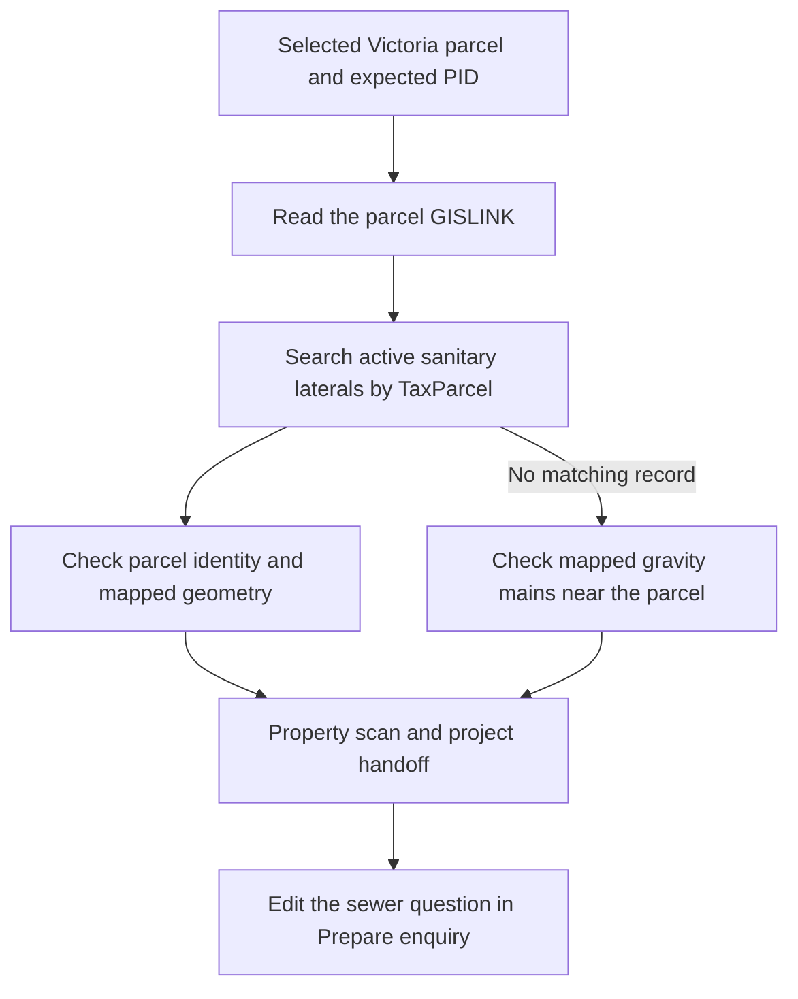

# What can the City map tell an owner about a proposed dwelling's sewer connection?



The preliminary property scan shows the mapped service and keeps the source
records in its evidence disclosure. Prepare enquiry suggests a builder question
about capacity and upgrades when the City maps a parcel-linked active connection.
Otherwise it asks how to confirm service. Homeowners can edit or remove the
question before copying or exporting their enquiry. A capacity finding would need an answer covering
the actual proposal, the authority, date and any conditions. [City connection enquiries](https://www.victoria.ca/building-business/permits-development-construction/building-renovating/apply-permit/plumbing)

## Public source checks

The City publishes separate parcel, lateral and main layers. The parcel's
`OBJECTID` selects a polygon in the parcel layer. Its `GISLINK` is the string
to compare with the lateral's `TaxParcel`, including leading zeros. A provincial
PID can corroborate the selected parcel. It serves a different purpose from the
utility join key. [Parcels](https://maps.victoria.ca/server/rest/services/OpenData/OpenData_Land/MapServer/11) · [Sewer laterals](https://maps.victoria.ca/server/rest/services/OpenData/OpenData_Sewer/MapServer/12) · [Gravity mains](https://maps.victoria.ca/server/rest/services/OpenData/OpenData_Sewer/MapServer/4)

Public spot checks on November 19, 2026 included the saved 419 Cecelia map parcel
10573 (GISLINK 10746004, lateral 2420) and May Street parcel 87 (GISLINK 03229041,
lateral 4280). Other selected polygons expose why the key alone is insufficient.
Polygons 14516 and 14517 share key 01004001 and lateral 6738. Parcel 94 has two
lateral records under key 03229037. A map record can also be slightly displaced
from a parcel edge. These identifiers support repeating the public queries and can
change when the City revises its maps.

An independent comparison restricted to active, Victoria-owned and
Victoria-jurisdiction records with water type SEW found 13,832 laterals.
13,751 had an exact GISLINK match in the PID-based parcel layer. The 12,269
distinct matching keys included 462 shared by several polygons. These are asset
and key counts. They do not measure household coverage or connection accuracy.

The active Victoria-jurisdiction lateral layer included a storm water-type row and
a potable water-type row on the check date. Filtering by utility type is necessary
even in the sewer layer. The search covers municipal mapped assets. The City
notes that recent work can take time to appear. A scoped empty search leaves the
property's physical service unresolved. Contains information licensed under the
Open Government Licence – City of Victoria. [City map limitations](https://www.victoria.ca/building-business/maps) · [City open data licence](https://opendata.victoria.ca/pages/open-data-licence)

## Interpreting the result

| Map evidence | What the homeowner can take to the City |
| --- | --- |
| One active City sanitary lateral, a unique parcel key and a corroborating endpoint | The map associates an existing connection with the selected parcel. Confirm whether it can be reused for the proposed demand. |
| A shared key, multiple candidate lines or an inconsistent mapped location | Ask Engineering which service reaches this dwelling. |
| No matching lateral, with an eligible gravity main within 20 m of the parcel | A main is mapped nearby. Ask how a connection could be made. The search radius is a map filter and supplies no design criterion or permission. |
| No matching lateral or nearby gravity main in the searched layers | Ask Engineering where the service is recorded. The result gives no basis for assuming that the property lacks sewer. |
| Lookup incomplete | Retry the public map or ask Engineering. If only the main check failed, the completed lateral search still applies. |

The one-metre endpoint tolerance accommodates small digitizing offsets observed
between the two City layers. It is a pilot matching rule. An endpoint 0.02 m
from a parcel edge can corroborate its unique key; a distant endpoint prompts
review. Geometry alone never assigns a service.

## Repeating the software and source checks

The stateless application serves the scan at
`POST /api/victoria-zoning/property-scan`. For example, submit the following JSON
for the saved Cecelia property. See the README for the local demo startup command.

```json
{"schema_version":"victoria-property-scan.v1","parcel_ref":{"source":"city-of-victoria-pid-parcels","object_id":10573},"expected_pid":"008-118-221"}
```

The following live calls passed through that route during implementation on
November 19. The six planning findings remained a separate response field.

| Selected parcel object ID | Observed sewer result |
| --- | --- |
| 10573 and 87, each with its own expected PID | Mapped connection |
| 12 | No matching lateral. Main 1957 was 9.23 m from the parcel. |
| 29 | No matching lateral or eligible main within 20 m |
| 52 | Ambiguous. The only linked lateral, 13622, was about 73 m from the parcel. |
| 14516 | Ambiguous. Two parcel polygons share the matching key. |
| 94 | Ambiguous. Two active sanitary lateral records match. |
| 10573 with parcel 87's PID | Unavailable. Selected-parcel identity check failed. |

All responses retained the need for demand-specific confirmation. These are dated
public observations. The isolated regressions use controlled City responses so CI
can exercise the same distinctions and source failure without relying on live maps.

During the original pilot, a local Chrome check opened the saved 419 Cecelia example at 390 px and 1440 px,
read the live mapped result, opened the Engineering email draft by keyboard and
selected Garden suite. From Prepare enquiry it downloaded the ZIP and checked the
manufacturer message, supporting report and technical JSON. Both widths preserved
the sanitary finding and lateral 2420. Nothing was sent. Run the focused backend
checks with `uv run --locked pytest tests/test_victoria_zoning_api.py`. From
`frontend/`, `npm test` exercises the scan-to-handoff regression and
`npm run build` checks the production bundle. The PR records final-head CI and
independent verification on the merged revision.

## Review and expansion

| Open question | Practical impact and owner |
| --- | --- |
| Does the map identify the right connection or enquiry on difficult sites? | An independent servicing reviewer could compare 20 properties against authorized drawings, including corner lots, shared connections and absent records. The research proposal calls for at least 18 correct connections or next enquiries, zero wrong-parcel assignments and zero unsupported capacity claims before adding another service. Owner consent, paid plans or professional review would be arranged separately. |
| Can the proposed dwelling use the service? | The property owner or project team should seek City Engineering's demand-specific response when the design warrants it. A mapped line alone supplies no capacity, upgrade cost or approval. |
| Can homeowners use the result in a discovery call? | The product team should observe homeowners locating the finding and formulating the next question. Software checks establish the displayed information and exported wording. Homeowner comprehension remains unmeasured. |
| What about water, storm drainage, power or another municipality? | Each needs its own source, operator, association checks and demand question. This pilot covers Victoria sanitary sewer only. |

Review of privately held plans falls outside the public map check. [Victoria permit-records access](https://www.victoria.ca/building-business/permits-development-construction/building-renovating/accessing-permit-records)
